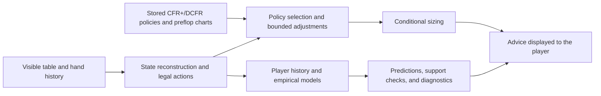

# PokerNow Assistant

Poker decision support combining stored CFR+/DCFR policies, legal-action checks, conditional sizing, player statistics, and empirical opponent models. The Assistant reads table state and hand histories, displays advice, and leaves betting decisions to the player.

[Research paper](report/main.pdf) · [Paper source](report/main.tex) · [Training notebooks](notebooks) · [Results](results)

The evaluated prediction models are LightGBM, XGBoost, CatBoost, and Extra Trees ensembles. Deep CFR and related deep-learning papers informed the research; the selected empirical models in this release are not neural networks.

## How it works



This diagram describes the later runtime. Earlier Testing versions blended supported model predictions into experimental recommendations; the later version keeps them diagnostic. The paper distinguishes both behaviors.

## Project layout

| Path | Contents |
|---|---|
| `src/assistant/` | Assistant interface, browser/log readers, policy adapters, compiled strategy assets, inference code, and regression checks |
| `src/solver/` | CFR+/DCFR engine and River root/training/evaluation contracts |
| `src/training/stage6/` | Feature construction, nine-layer model selection, calibration, refitting, installation, and replay preparation |
| `src/training/stage7/` | Frozen-model evaluation, cohort construction, range diagnostics, hierarchical player/session history, and result validation |
| `notebooks/stage6/` | 47 feature-freeze, model-fold, and aggregation notebooks |
| `notebooks/stage7/` | Five evaluation and history-experiment notebooks |
| `notebooks/solver/river_r22/` | 17 River solver cohort and aggregation notebooks |
| `notebooks/packages/` | Exact code/input-contract packages required by those notebooks; `notebooks/dependencies.json` maps the dependencies |
| `models/` | Five compressed weight/metadata packages and their extraction manifest |
| `results/` | Numerical model, solver, runtime, and gameplay findings used in the paper |
| `scripts/` | Model installation, report assets, and research-analysis utilities |
| `tests/` | Synthetic cash-flow accounting tests |
| `data/private_runtime_assets.json` | Required private inputs for the optional historical Testing worker; actual private records are excluded |
| `report/` | PDF, TeX, bibliography, figures, and tables |

Source directories retain loader-relative filenames. Names such as `stage021_archive_primary_policy.json` refer to the active compiled policy, not a development backup. Notebook packages and compressed model weights are execution inputs; the weight packages retain 12 model cards describing their models. Obsolete checkpoints, result archives, and development plans are excluded.

## Finding the implementation

| Method | Starting point |
|---|---|
| Nine-layer features and historical support | [Additional layer features](src/training/stage6/stage6_additional_exploitation_layers.py), [within-hand features](src/training/stage6/stage6_expanded_layers.py) |
| Chronological model selection and installed refits | [Nested search](src/training/stage6/stage6_retrospective_nested_search.py), [refit and installation](src/training/stage6/stage6_retrospective_nested_refit_install.py) |
| Frozen-model replay and confirmation comparisons | [Replay preparation](src/training/stage7/stage6_empirical_preparation_v2.py), [evaluation](src/training/stage7/stage6_empirical_evaluation_v2.py), [result validation](src/training/stage7/stage6_empirical_result_import_v2.py) |
| Range likelihoods and cohort boundaries | [Range model](src/training/stage7/stage6_empirical_range_learning_v2.py), [cohort construction](src/training/stage7/stage6_empirical_range_plan_v2.py) |
| Population, player, and session history | [Hierarchical response](src/training/stage7/stage7_hierarchical_response_v1.py) |
| Terminal-value diagnostic | [Terminal replay](src/training/stage7/stage6_empirical_terminal_replay_v2.py) |
| CFR+/DCFR training | [Solver source](src/solver/stage21_baseline), [River notebooks](notebooks/solver/river_r22) |
| Recorded winnings and historical recommendation influence | [Ledger analysis](scripts/analyze_stackhud_rates.py), [runtime-history analysis](scripts/audit_runtime_history.py) |

## Setup and commands

Use Node.js 24 and Python 3.12 or later. Run from the repository root:

```text
npm --prefix src/assistant ci
python -m pip install -r requirements-inference.txt
python scripts/materialize_runtime.py
```

The installer checks and extracts declared models and creates the training-module layout expected by the runtime. It refuses to overwrite changed files. Extracted weights and generated runtime copies are Git-ignored.

Offline checks:

```text
npm --prefix src/assistant run ml:test-stage021-archive-primary
npm --prefix src/assistant run ml:test-stage021-controlled-bluffs
npm --prefix src/assistant run ml:test-stage6-assistant-testing-lifecycle
python -m unittest discover -s tests -v
```

Launch with an explicit game and player:

```text
npm --prefix src/assistant run ml:assistant-live-dual-log -- --game-id YOUR_GAME_ID --hero-name YOUR_PLAYER_NAME --open
```

Browser setup, user-owned hand histories, and local configuration are required. The optional Testing worker also needs the exact private history, identity mapping, range artifact, and closure files listed in `data/private_runtime_assets.json`; it abstains when required inputs are missing. The primary compiled policy is separate. Optional environment settings are in `src/assistant/.env.example`; keep credentials in an ignored `.env`.

Historical Colab notebooks retain their declared Drive layouts, package identities, and input/checkpoint expectations. Place matching packages from `notebooks/packages/` in the notebook's requested location. The dependency index distinguishes included packages from private inputs supplied separately. Source-preparation utilities also retain the original producer workspace conventions. Raw player histories, database exports, and identity maps are not distributed; full historical training requires those private inputs.

For paper assets:

```text
python -m pip install -r requirements-report.txt
python scripts/build_report_assets.py
```

Compile `report/main.tex` with pdfLaTeX/BibTeX or Tectonic, or upload the contents of `report/` to Overleaf. Calculation tools expose input arguments through `--help`; they do not connect to a live table or database automatically.

## Results in context

The selected postflop predictor reaches 67.37% observed-action accuracy. Earlier Testing logs confirm that learned fusion changed some recommendations; later versions use those predictions diagnostically with zero strategy weight. The River policy incorporates 67 corrected roots with two CFR+ and two DCFR lanes each, plus 13 unmatched prior roots.

The gameplay point estimate is +486.37 BB / 66.49 corrected hours = +7.31 BB/hour across 32 eligible games. The duration was supplied by the project author and is not independently verified; corrected game-level hours are unavailable, so no revised hourly-rate confidence interval is reported. This is not a causal estimate of the Assistant's benefit. Details and limitations are in the paper and numerical results.
