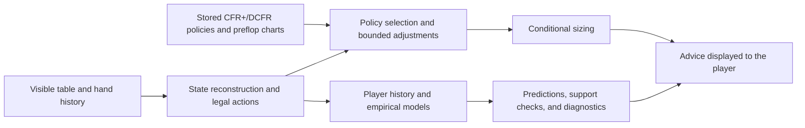

# PokerNow Research Methods

Research on poker decision support using CFR+/DCFR policies, player statistics, and empirical opponent models. This repository contains the paper, training and evaluation methodology, notebooks, and aggregate results. Trained model weights and the live Assistant application are not distributed.

[Research paper](report/main.pdf) · [Paper source](report/main.tex) · [Training notebooks](notebooks) · [Results](results)

The evaluated prediction models are LightGBM, XGBoost, CatBoost, and Extra Trees ensembles. Deep CFR and related deep-learning papers informed the research; the selected empirical models evaluated in the paper are not neural networks.

## System studied



This diagram describes the later runtime. Earlier Testing versions blended supported model predictions into experimental recommendations; the later version keeps them diagnostic. The paper distinguishes both behaviors.

## Project layout

| Path | Contents |
|---|---|
| `src/solver/` | CFR+/DCFR engine and River root/training/evaluation contracts |
| `src/training/stage6/` | Feature construction, nine-layer model selection, calibration, refitting, installation, and replay preparation |
| `src/training/stage7/` | Frozen-model evaluation, cohort construction, range diagnostics, hierarchical player/session history, and result validation |
| `notebooks/stage6/` | 47 feature-freeze, model-fold, and aggregation notebooks |
| `notebooks/stage7/` | Five evaluation and history-experiment notebooks |
| `notebooks/solver/river_r22/` | 17 River solver cohort and aggregation notebooks |
| `notebooks/packages/` | Exact code/input-contract packages required by those notebooks; `notebooks/dependencies.json` maps the dependencies |
| `results/` | Numerical model, solver, runtime, and gameplay findings used in the paper |
| `scripts/` | Report assets and research-analysis utilities |
| `tests/` | Synthetic cash-flow accounting tests |
| `data/private_runtime_assets.json` | Input requirements for historical diagnostics; private records are excluded |
| `report/` | PDF, TeX, bibliography, figures, and tables |

Historical source and notebook filenames are retained for methodological traceability. Notebook packages contain research code and contracts; the terminal-replay package that bundled Assistant runtime modules is not distributed. Development plans and obsolete result archives remain excluded.

## Finding the implementation

| Method | Starting point |
|---|---|
| Nine-layer features and historical support | [Additional layer features](src/training/stage6/stage6_additional_exploitation_layers.py), [within-hand features](src/training/stage6/stage6_expanded_layers.py) |
| Chronological model selection and installed refits | [Nested search](src/training/stage6/stage6_retrospective_nested_search.py), [refit and installation](src/training/stage6/stage6_retrospective_nested_refit_install.py) |
| Frozen-model replay and confirmation comparisons | [Replay preparation](src/training/stage7/stage6_empirical_preparation_v2.py), [evaluation](src/training/stage7/stage6_empirical_evaluation_v2.py), [result validation](src/training/stage7/stage6_empirical_result_import_v2.py) |
| Range likelihoods and cohort boundaries | [Range model](src/training/stage7/stage6_empirical_range_learning_v2.py), [cohort construction](src/training/stage7/stage6_empirical_range_plan_v2.py) |
| Population, player, and session history | [Hierarchical response](src/training/stage7/stage7_hierarchical_response_v1.py) |
| Terminal-value diagnostic | [Terminal replay](src/training/stage7/stage6_empirical_terminal_replay_v2.py) |
| CFR+/DCFR training | [Solver source](src/solver/stage21_baseline), [River notebooks](notebooks/solver/river_r22) |
| Recorded winnings and historical recommendation influence | [Ledger analysis](scripts/analyze_stackhud_rates.py), [runtime-history analysis](scripts/audit_runtime_history.py) |

## Working with the research files

Use Python 3.12 or later. The historical model-development dependencies remain in `requirements-inference.txt`:

```text
python -m pip install -r requirements-inference.txt
python -m unittest discover -s tests -v
```

The source documents the training, feature construction, validation, and analysis methods. Some historical evaluations require privately held trained models, source data, or runtime inputs and cannot run from this public repository alone. There is no public Assistant installation or launch command.

Historical Colab notebooks retain their declared Drive layouts, package identities, and input/checkpoint expectations. Place matching packages from `notebooks/packages/` in the notebook's requested location. The dependency index distinguishes included research packages from private inputs and runtime packages. Source-preparation utilities also retain the original producer workspace conventions. Raw player histories, database exports, and identity maps are not distributed; full historical training requires those private inputs.

For paper assets:

```text
python -m pip install -r requirements-report.txt
python scripts/build_report_assets.py
```

Compile `report/main.tex` with pdfLaTeX/BibTeX or Tectonic, or upload the contents of `report/` to Overleaf. Calculation tools expose input arguments through `--help`; they do not connect to a live table or database automatically.

## Results in context

The selected postflop predictor reaches 67.37% observed-action accuracy. Earlier Testing logs confirm that learned fusion changed some recommendations; later versions use those predictions diagnostically with zero strategy weight.

The gameplay point estimate is +486.37 BB / 66.49 corrected hours = +7.31 BB/hour across 32 eligible games.
